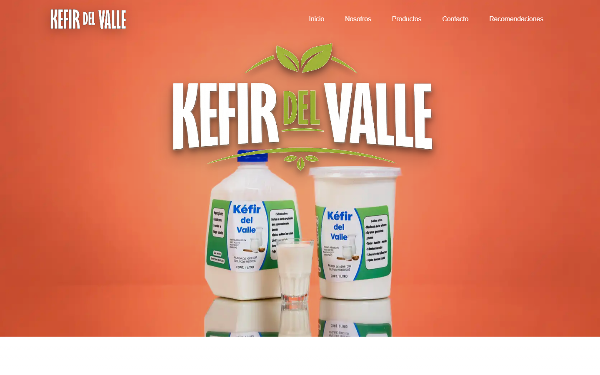
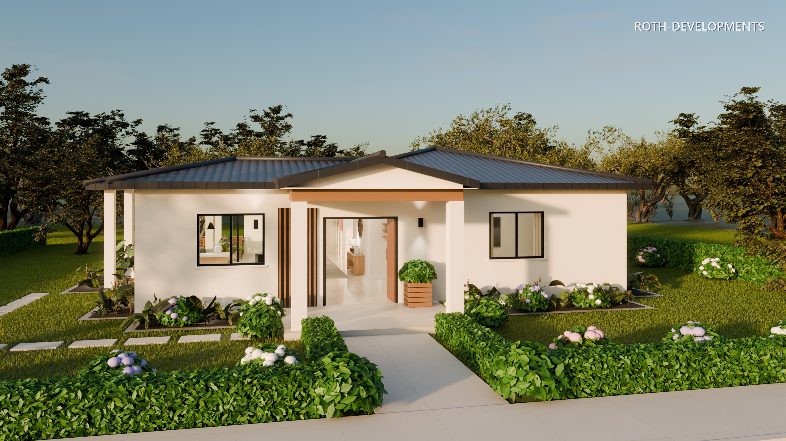

# ROTH-DEVELOPMENTS · Portafolio

Desarrollo web, sistemas a medida y visualización arquitectónica 3D.

Este repositorio es una vitrina de proyectos realizados. Muestra el resultado de cada trabajo: imágenes, alcance y tecnologías.

> **Sobre el código fuente:** los proyectos aquí mostrados se hicieron para clientes. Su código y sus archivos de trabajo son privados y no se publican. Las imágenes se muestran únicamente como referencia del trabajo realizado.

## Proyectos

| Proyecto | Tipo | Estado |
| --- | --- | --- |
| [Kéfir del Valle](proyectos/kefir-del-valle/) | Sitio web comercial | En producción: [kefirdelvalle.com](https://kefirdelvalle.com/) |
| [Casa residencial de un nivel](proyectos/casa-residencial/) | Diseño, modelado 3D y renders | Entregado |

### Kéfir del Valle

Sitio web con catálogo de productos y pedidos por WhatsApp para una marca de bebidas fermentadas artesanales.

### Casa residencial de un nivel

Proyecto arquitectónico completo a partir de croquis a mano: planos, modelo BIM, renders fotorrealistas y recorrido virtual.

## Servicios

- Sitios web y landing pages para negocios
- Sistemas y aplicaciones a medida
- Planos, modelado 3D, renders y recorridos virtuales de viviendas

## Contacto

Por medio del perfil de GitHub: [@roth-dvp](https://github.com/roth-dvp)

---

© ROTH-DEVELOPMENTS. Todos los derechos reservados. Las imágenes y marcas de los clientes pertenecen a sus respectivos dueños.
