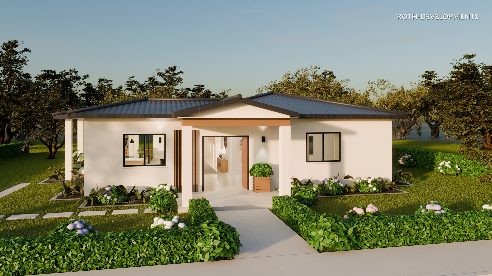
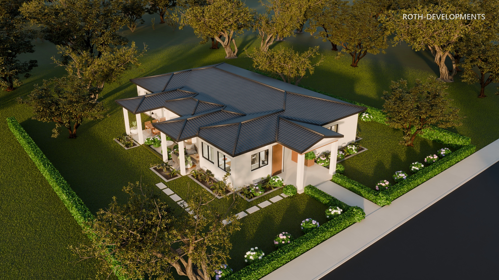
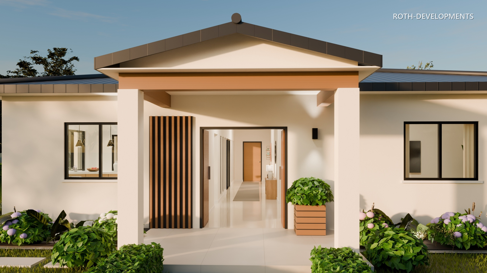
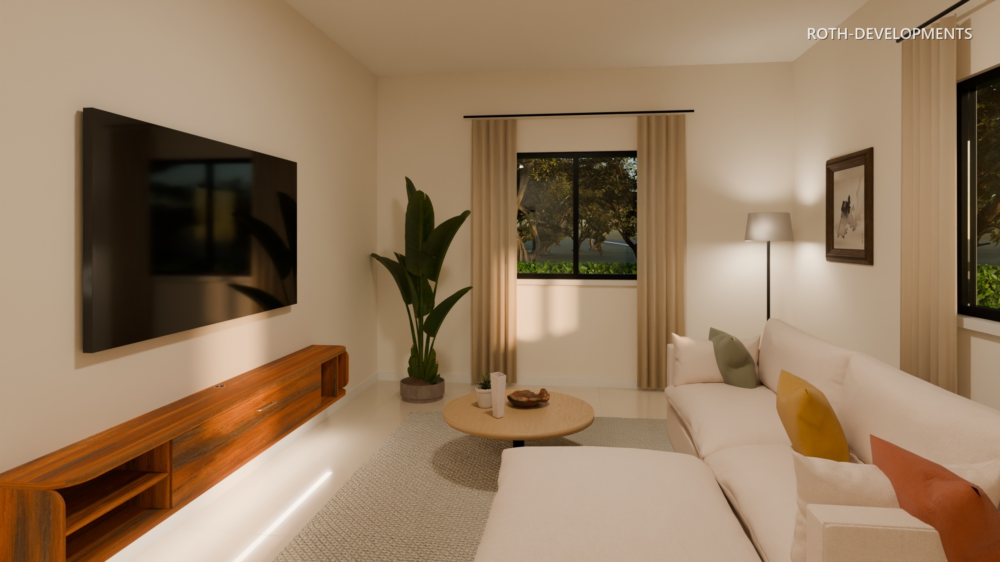
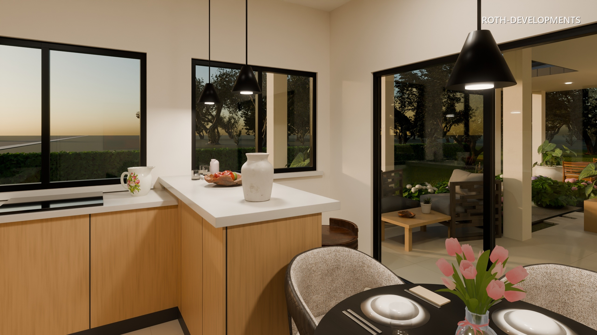
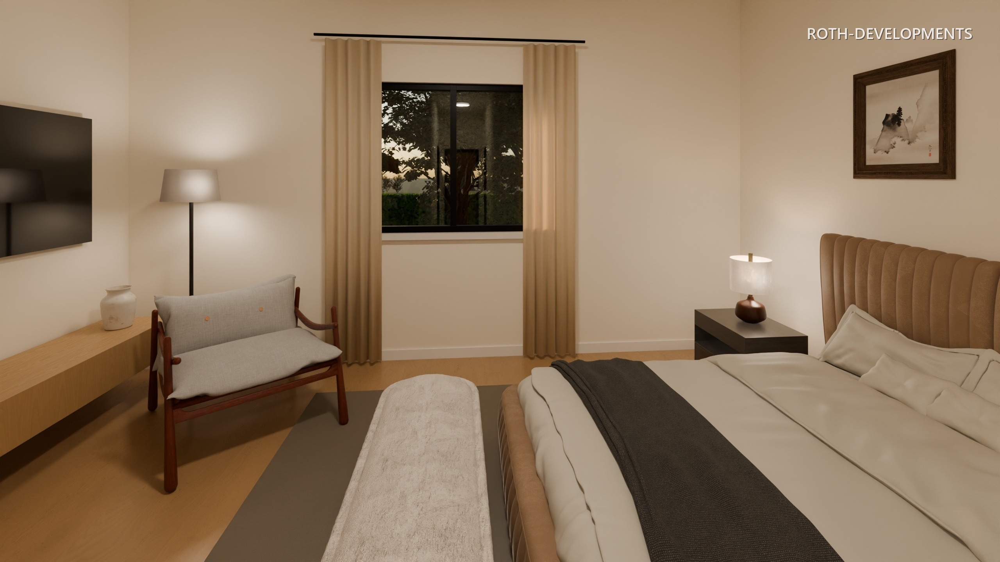
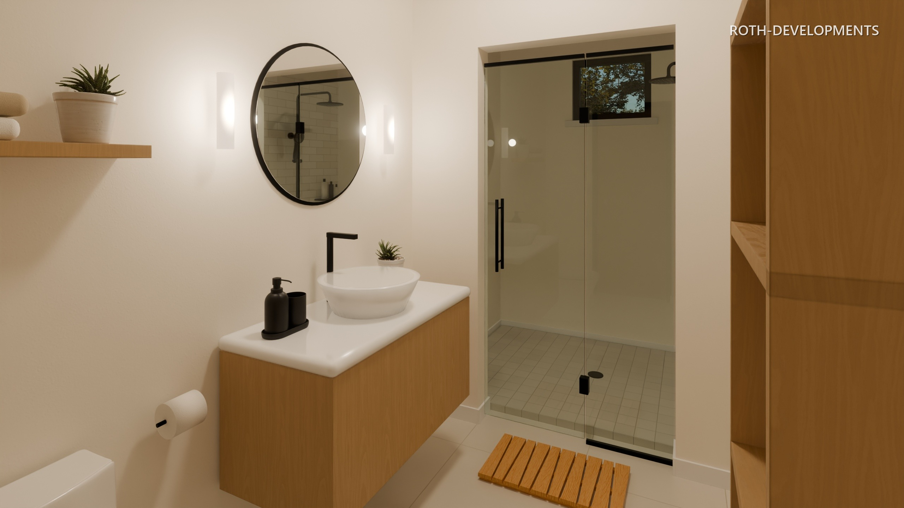
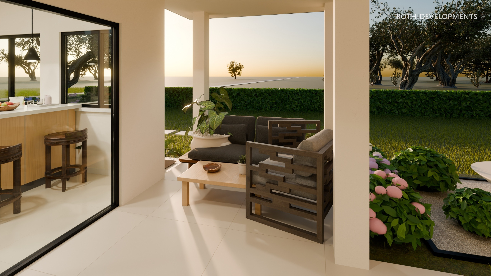
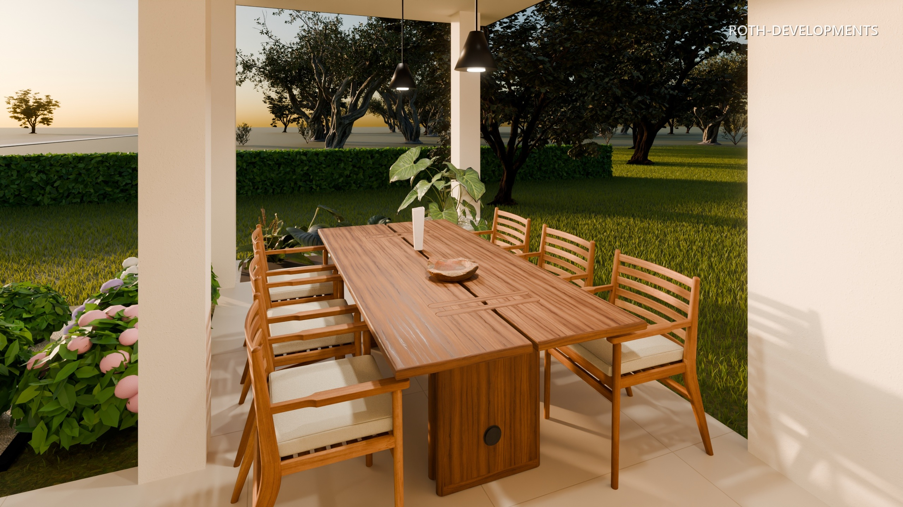
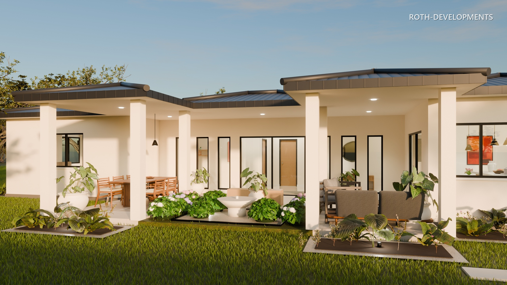

# Casa residencial de un nivel

Proyecto arquitectónico de una vivienda de un nivel, desarrollado a partir de croquis hechos a mano por el propietario.

> Proyecto de cliente particular. Los planos, medidas, ubicación y archivos de trabajo son privados. Aquí se muestran solo imágenes de presentación.

## Alcance

- Levantamiento de la distribución a partir de croquis a mano
- Planos arquitectónicos: planta, techos, fachadas y cortes
- Modelo BIM (IFC) y cantidades de obra
- Renders fotorrealistas de exteriores e interiores
- Recorrido virtual continuo en video
- Varias rondas de cambios con el propietario, cada una con vistas previas para aprobar

## Características del diseño

- Tres dormitorios, vestidor y dos baños
- Sala, cocina con desayunador y comedor
- Pórtico de acceso a dos aguas
- Patio interior con corredor techado, sala y comedor exteriores
- Jardinería formal

## Herramientas

- Python: modelo paramétrico que genera planos, cantidades y escenas desde un solo archivo de parámetros
- FreeCAD: modelo BIM e IFC
- Blender (Cycles): renders y video

## Galería

| | |
| --- | --- |
|  |  |
|  |  |
|  |  |
|  |  |

---

[Volver al portafolio](../../)
