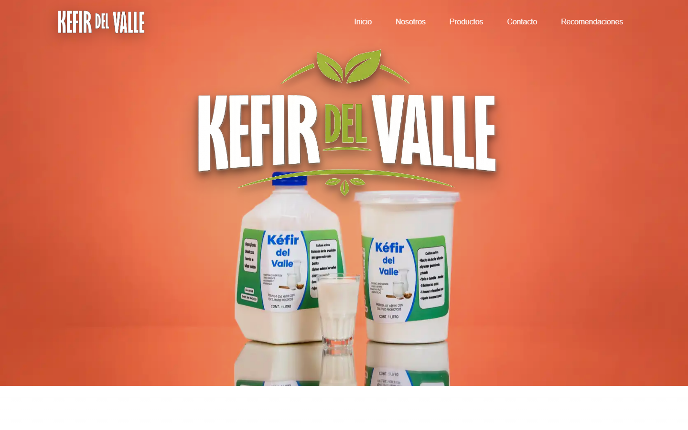

# Kéfir del Valle

Sitio web comercial para una marca de bebidas fermentadas artesanales de kéfir.

**Sitio en producción:** [kefirdelvalle.com](https://kefirdelvalle.com/)

> Proyecto de cliente. El código fuente es privado. Las capturas corresponden al sitio público.

## Alcance

- Página principal con presentación de la marca, beneficios del producto y guía de consumo
- Catálogo con una página individual por producto
- Pedidos directos por WhatsApp
- Sección de contenido de redes sociales con video
- Diseño adaptable a celular, tableta y escritorio
- SEO: mapa del sitio, URL canónicas y páginas por producto
- Instalable como aplicación (PWA básica)

## Tecnologías

- HTML5, CSS3 y JavaScript puro, sin frameworks
- Imágenes WebP y video MP4/WebM optimizados
- Despliegue en Netlify con cabeceras de caché y seguridad

---

[Volver al portafolio](../../)
